---
## Author
author:
  name: Ко Антон Геннадьевич
  degrees: DSc
  orcid: 0000-0002-0877-7063
  email: antonkosakh@gmail.com
  affiliation:
    - name: Российский университет дружбы народов
      country: Российская Федерация
      postal-code: 117198
      city: Москва
      address: ул. Миклухо-Маклая, д. 6
## Title
title: Лабораторная работа №6
subtitle: Решение моделей в непрерывном и дискретном времени
license: CC BY
date: today
date-format: "YYYY-MM-DD" # Example: 2026-11-24
---

# Информация

## Докладчик

:::::::::::::: {.columns align=center}
::: {.column width="70%"}

  * Ко Антон Геннадьевич
  * студент
  * Российский университет дружбы народов им. П. Лумумбы
  * [1132221551@rudn.ru](mailto:1132221551@rudn.ru)
  * <https://SenDerMen04.github.io/ru/>

:::
::: {.column width="30%"}

:::
::::::::::::::

---

## 2. Выполнение лабораторной работы

Рассмотрим пример использования этого пакета для решения уравнения модели экспоненциального роста, описываемую уравнением, где $a$ — коэффициент роста.

Численное решение в Julia будет иметь следующий вид, а также график, соответствующий полученному решению (рис. #fig:001):

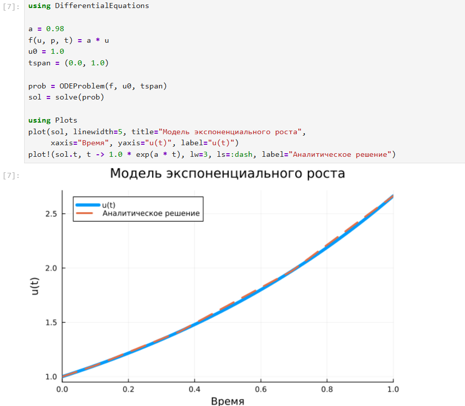

---

Если требуется задать точность решения, то можно воспользоваться параметрами `abstol` (задаёт близость к нулю) и `reltol` (задаёт относительную точность). По умолчанию эти параметры имеют значение `abstol = 1e-6` и `reltol = 1e-3`.

Для модели экспоненциального роста (рис. #fig:002):

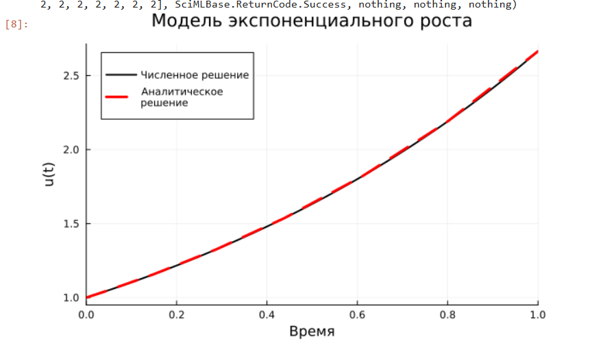

---

### 2.3. Система Лоренца

Решение системы неустойчиво на аттракторе, что не позволяет применять классические численные методы на больших отрезках времени, требуется использовать высокоточные вычисления.

Численное решение в Julia будет иметь следующий вид (рис. #fig:003):

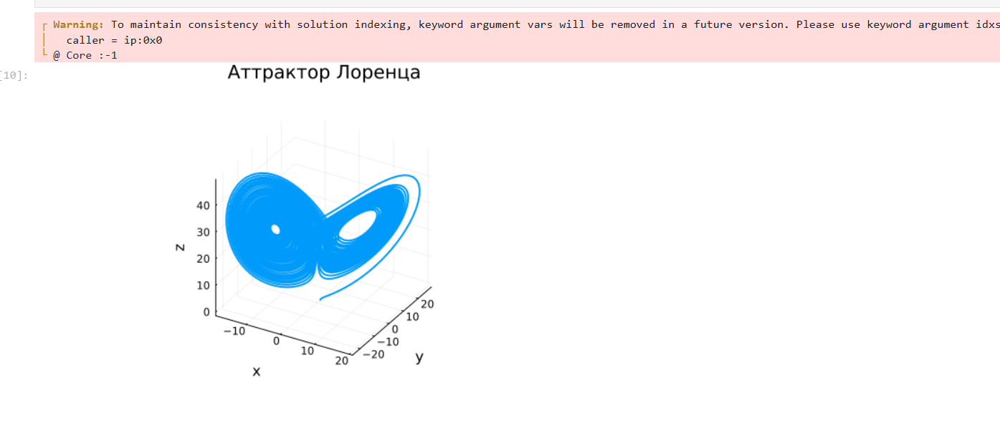

---

Можно отключить интерполяцию (рис. #fig:004):

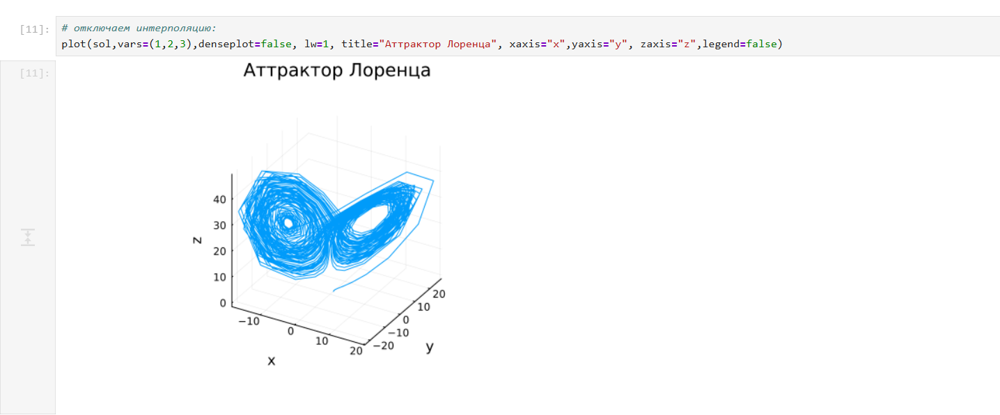

---

### 2.4. Модель Лотки–Вольтерры

Модель Лотки–Вольтерры описывает взаимодействие двух видов типа «хищник – жертва».

Численное решение в Julia будет иметь следующий вид (рис. #fig:005):

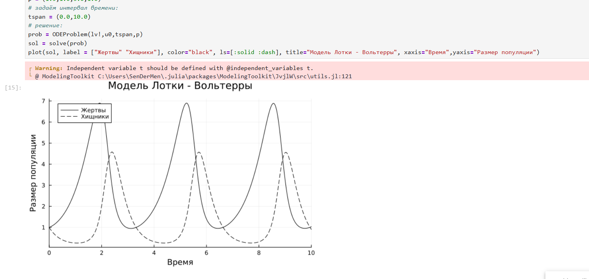

---

Фазовый портрет (рис. #fig:006):

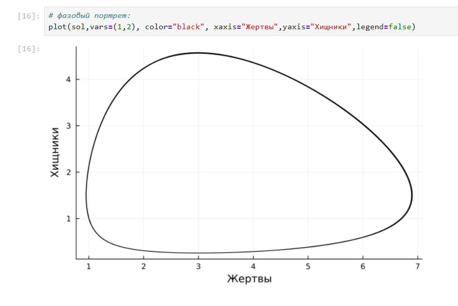

---

### 2.5. Самостоятельное выполнение

Выполнение задания №1 (рис. #fig:007):

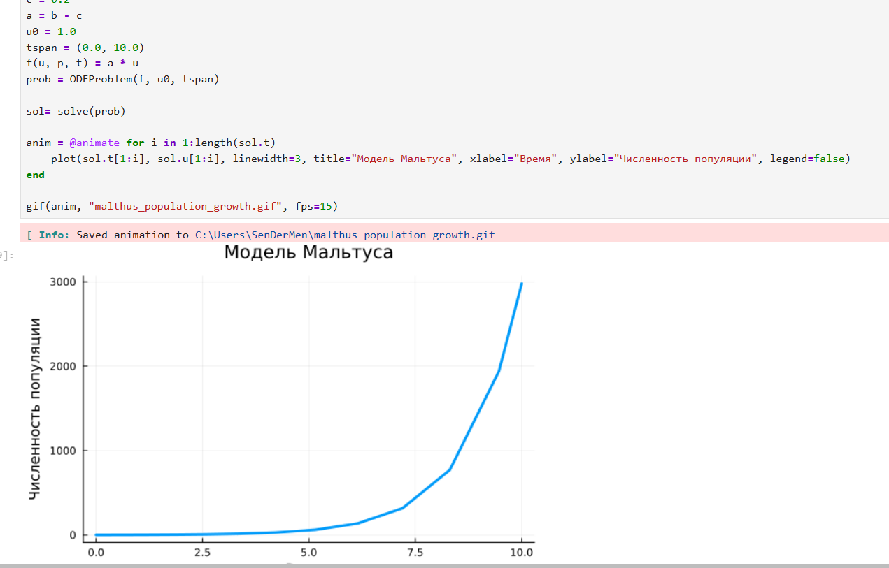

---

Выполнение задания №2 (рис. #fig:008):

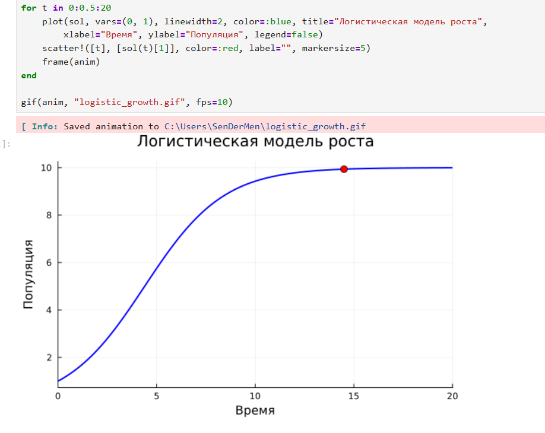

---

Выполнение задания №3 (рис. #fig:009):

---

*Рис. 2.9: Решение задания №3* (рис. #fig:009)

---

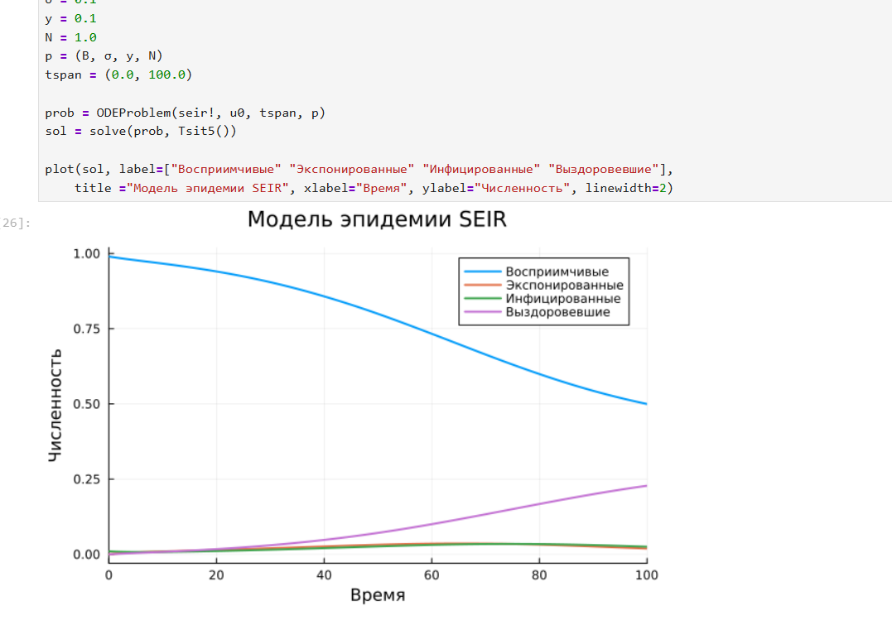

---

Выполнение задания №5 (рис. #fig:011):

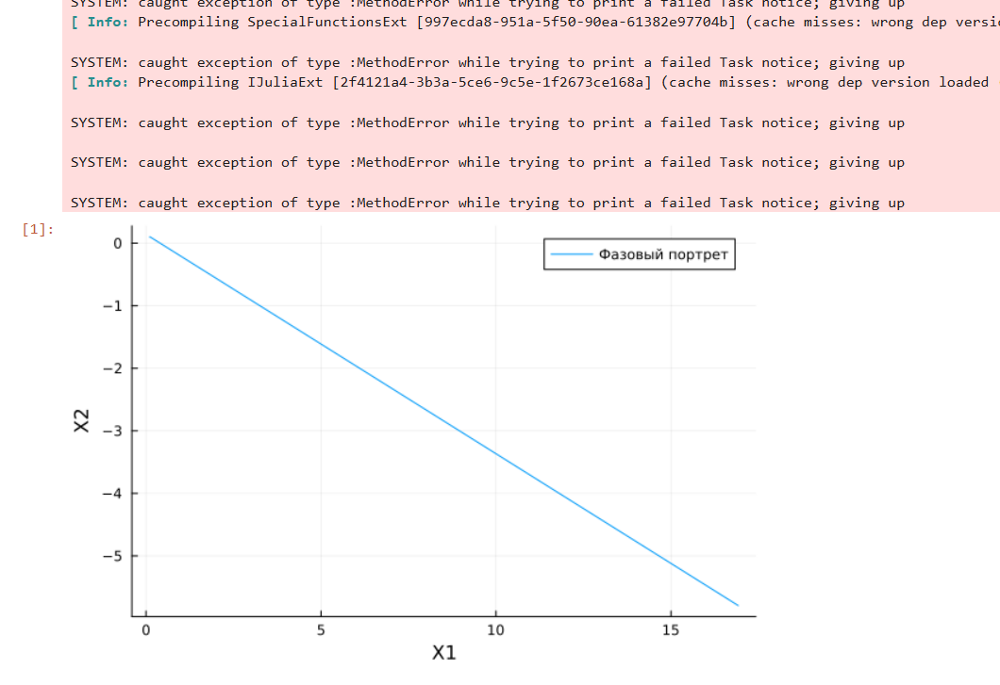

---

Выполнение задания №6 (рис. #fig:012):

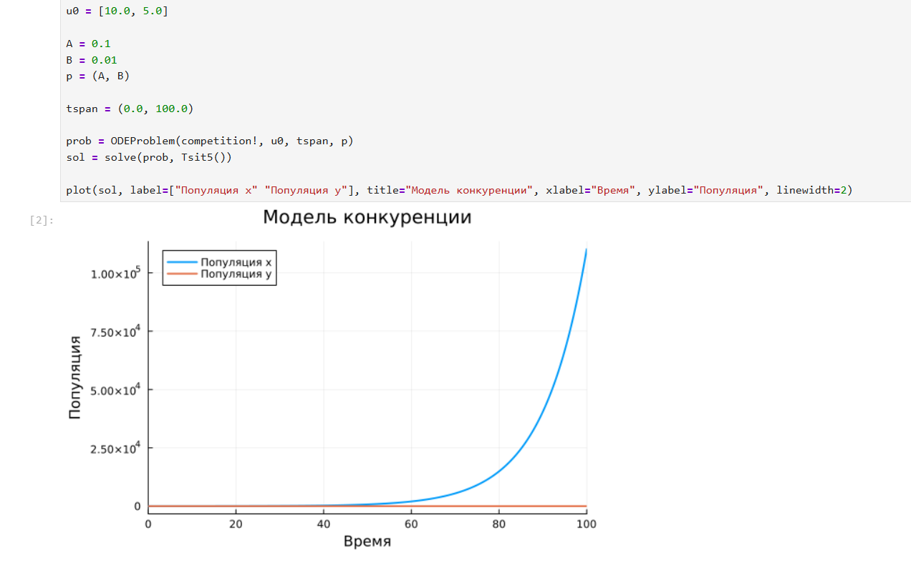

---

Выполнение задания №7 (рис. #fig:013):

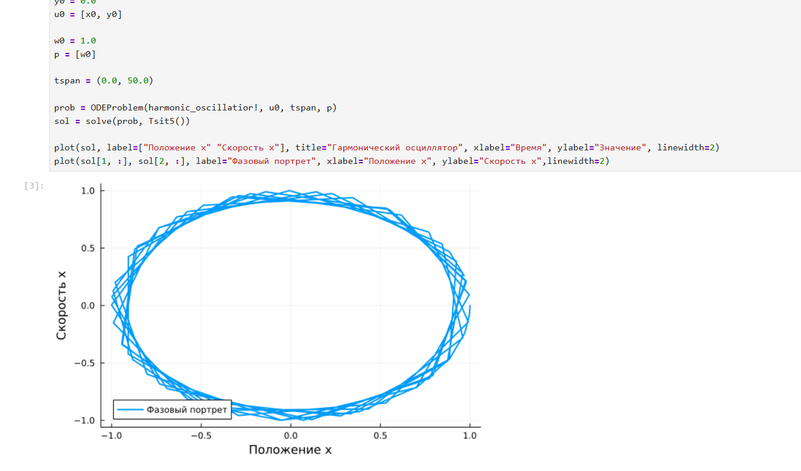

---

Выполнение задания №8 (рис. #fig:014):

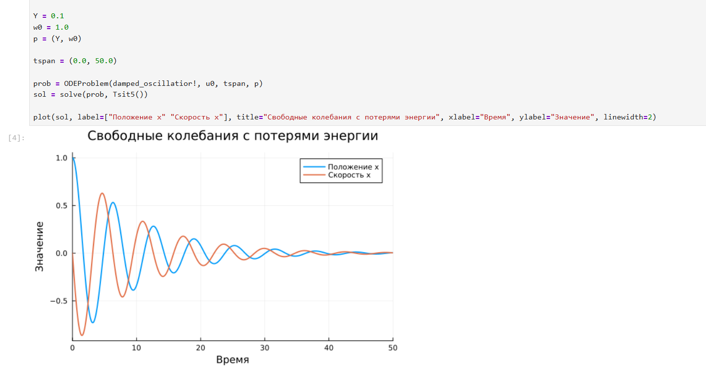

---

## 3. Вывод

В ходе выполнения лабораторной работы были освоены специализированные пакеты для решения задач в непрерывном и дискретном времени.
