---
## Author
author:
  name: Ко Антон Геннадьевич
  degrees: DSc
  orcid: 0000-0002-0877-7063
  email: antonkosakh@gmail.com
  affiliation:
    - name: Российский университет дружбы народов
      country: Российская Федерация
      postal-code: 117198
      city: Москва
      address: ул. Миклухо-Маклая, д. 6

## Title
title: "Лабораторная работа №6"
subtitle: "Решение моделей в непрерывном и дискретном времени"
license: "CC BY"
abstract: "В данном отчёте представлены результаты выполнения лабораторной работы по теме Julia. Линейная алгебра."
keywords: [лабораторная работа, алгебра, Markdown, Julia]
---

## 1. Цель работы

Основной целью работы является освоение специализированных пакетов для решения задач в непрерывном и дискретном времени.

---

## 2. Выполнение лабораторной работы

### 2.1. Решение обыкновенных дифференциальных уравнений

Вспомним, что обыкновенное дифференциальное уравнение (ОДУ) описывает изменение некоторой переменной $u$.

Для решения обыкновенных дифференциальных уравнений (ОДУ) в Julia можно использовать пакет `DifferentialEquations.jl`.

### 2.2. Модель экспоненциального роста

Рассмотрим пример использования этого пакета для решения уравнения модели экспоненциального роста, описываемую уравнением, где $a$ — коэффициент роста.

Численное решение в Julia будет иметь следующий вид, а также график, соответствующий полученному решению (рис. #fig:001):

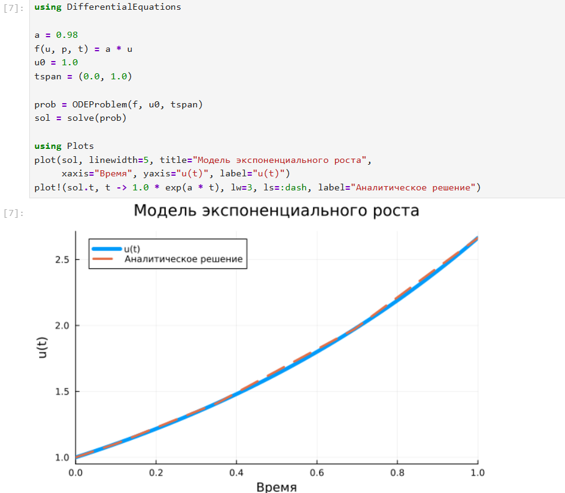

*Рис. 2.1: График модели экспоненциального роста* (рис. #fig:001)

При построении одного из графиков использовался вызов `sol.t`, чтобы захватить массив моментов времени. Массив решений можно получить, воспользовавшись `sol.u`.

Если требуется задать точность решения, то можно воспользоваться параметрами `abstol` (задаёт близость к нулю) и `reltol` (задаёт относительную точность). По умолчанию эти параметры имеют значение `abstol = 1e-6` и `reltol = 1e-3`.

Для модели экспоненциального роста (рис. #fig:002):

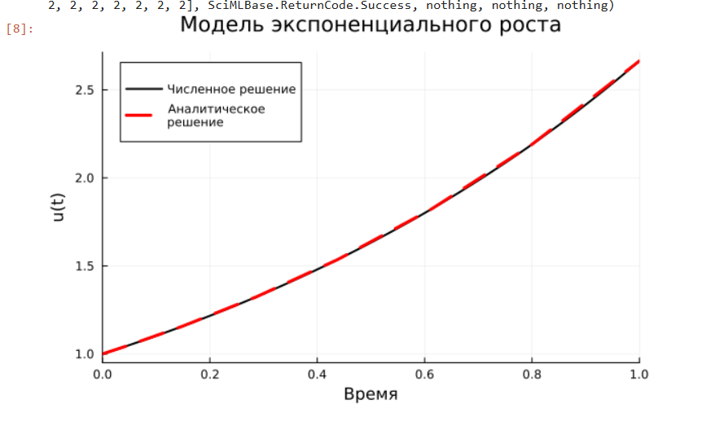

*Рис. 2.2: График модели экспоненциального роста (задана точность решения)* (рис. #fig:002)

### 2.3. Система Лоренца

Динамической системой Лоренца является нелинейная автономная система обыкновенных дифференциальных уравнений третьего порядка.

Система получена из системы уравнений Навье–Стокса и описывает движение воздушных потоков в плоском слое жидкости постоянной толщины при разложении скорости течения и температуры в двойные ряды Фурье с последующим усечением до первых-вторых гармоник.

Решение системы неустойчиво на аттракторе, что не позволяет применять классические численные методы на больших отрезках времени, требуется использовать высокоточные вычисления.

Численное решение в Julia будет иметь следующий вид (рис. #fig:003):

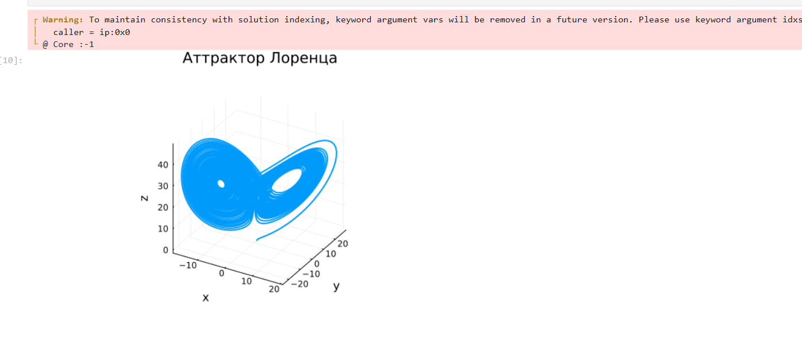

*Рис. 2.3: Аттрактор Лоренца* (рис. #fig:003)

Можно отключить интерполяцию (рис. #fig:004):

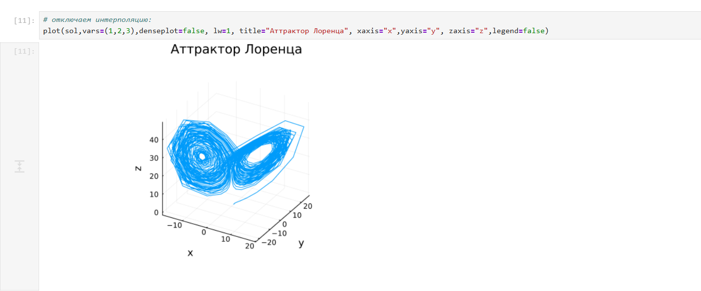

*Рис. 2.4: Аттрактор Лоренца (интерполяция отключена)* (рис. #fig:004)

### 2.4. Модель Лотки–Вольтерры

Модель Лотки–Вольтерры описывает взаимодействие двух видов типа «хищник – жертва».

Численное решение в Julia будет иметь следующий вид (рис. #fig:005):

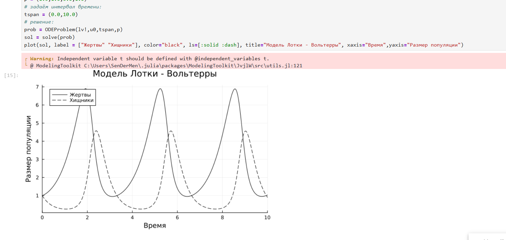

*Рис. 2.5: Модель Лотки–Вольтерры: динамика изменения численности популяций* (рис. #fig:005)

Фазовый портрет (рис. #fig:006):

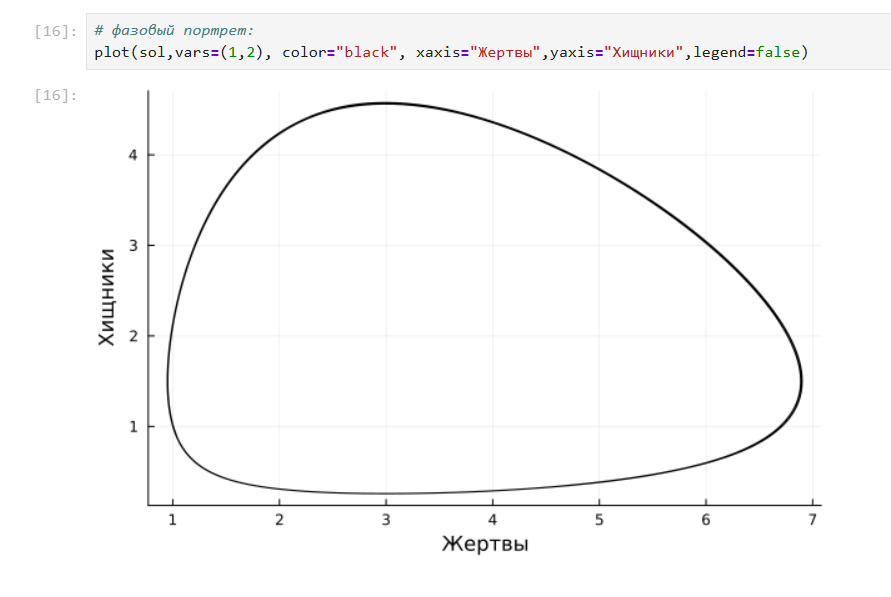

*Рис. 2.6: Модель Лотки–Вольтерры: фазовый портрет* (рис. #fig:006)

### 2.5. Самостоятельное выполнение

Выполнение задания №1 (рис. #fig:007):

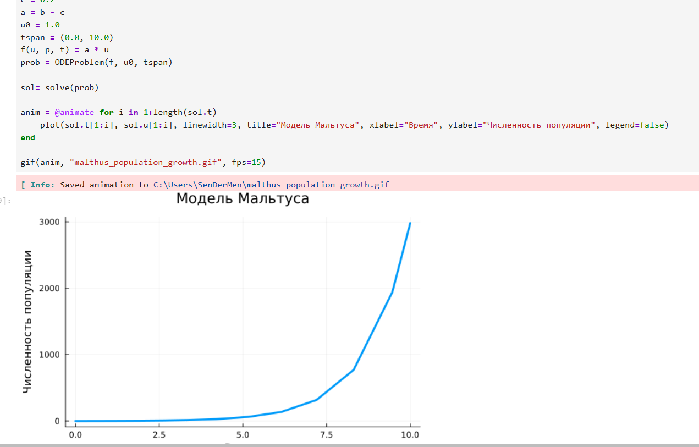

*Рис. 2.7: Решение задания №1* (рис. #fig:007)

Выполнение задания №2 (рис. #fig:008):

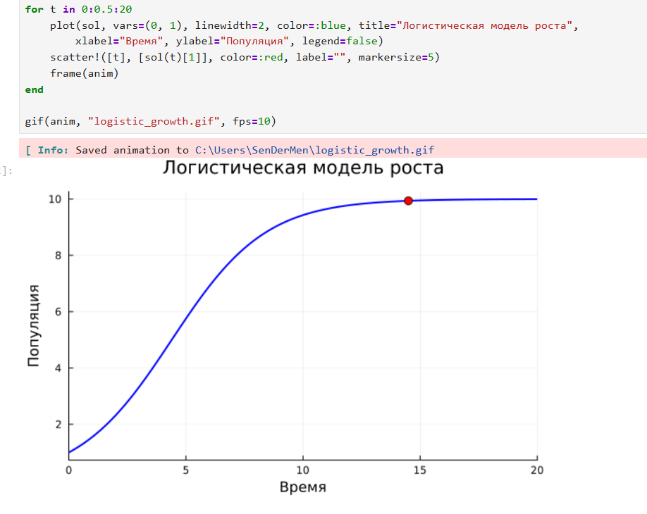

*Рис. 2.8: Решение задания №2* (рис. #fig:008)

Выполнение задания №3 (рис. #fig:009):

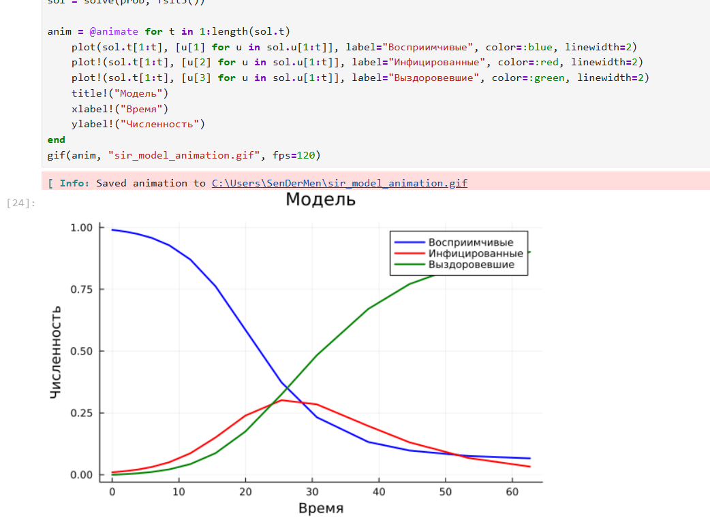

*Рис. 2.9: Решение задания №3* (рис. #fig:009)

Выполнение задания №4 (рис. #fig:010):

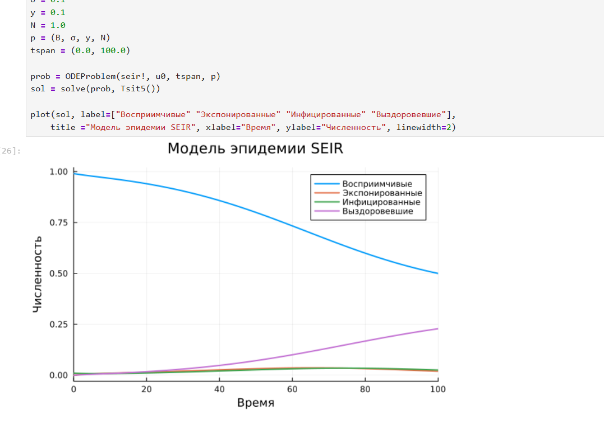

*Рис. 2.10: Решение задания №4* (рис. #fig:010)

Выполнение задания №5 (рис. #fig:011):

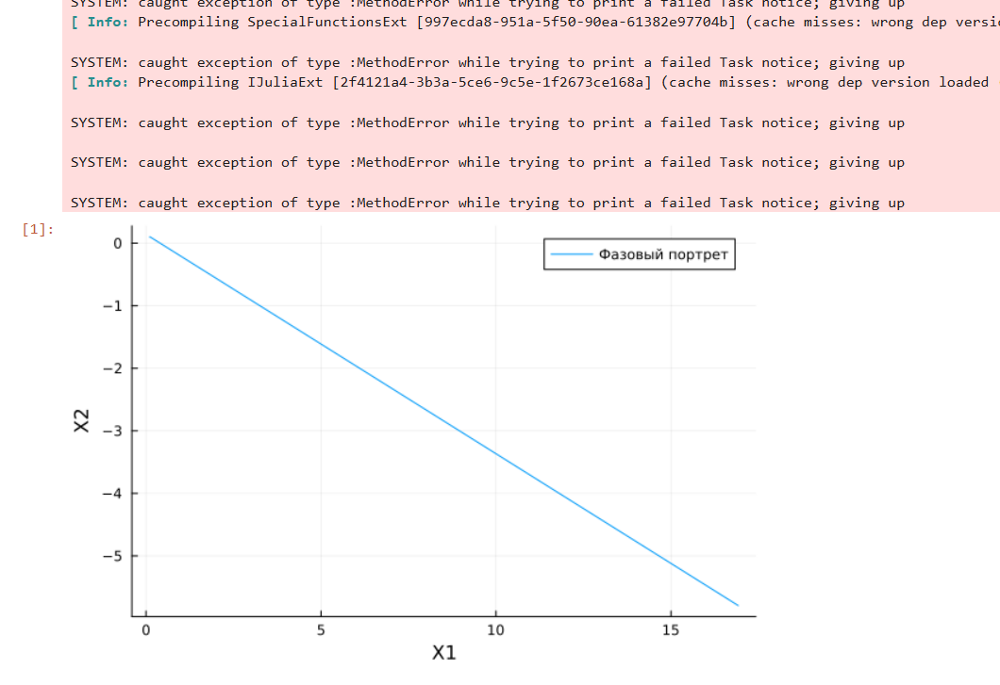

*Рис. 2.11: Решение задания №5* (рис. #fig:011)

Выполнение задания №6 (рис. #fig:012):

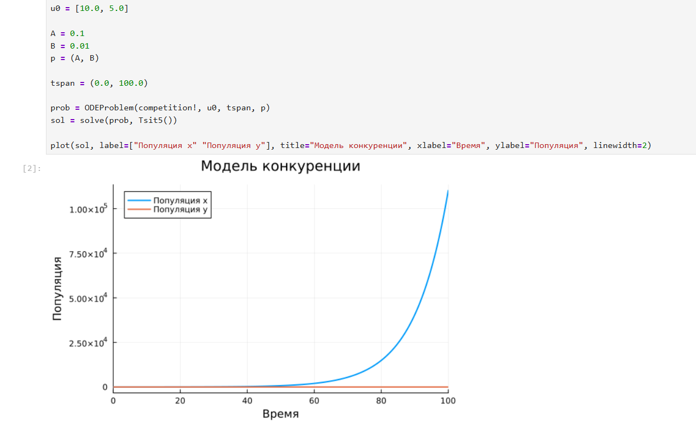

*Рис. 2.12: Решение задания №6* (рис. #fig:012)

Выполнение задания №7 (рис. #fig:013):

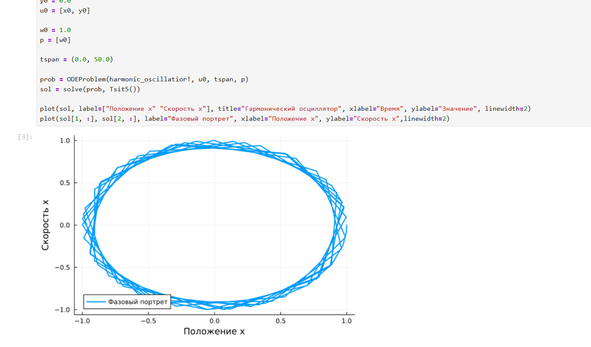

*Рис. 2.13: Решение задания №7* (рис. #fig:013)

Выполнение задания №8 (рис. #fig:014):

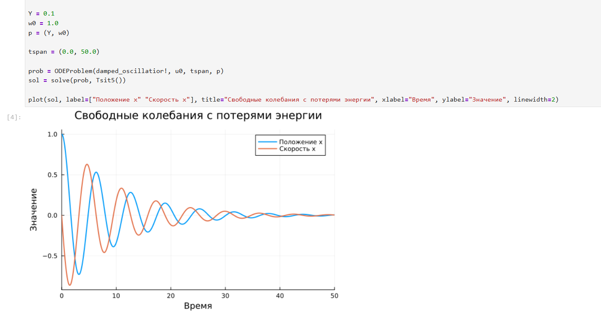

*Рис. 2.14: Решение задания №8* (рис. #fig:014)

---

## 3. Вывод

В ходе выполнения лабораторной работы были освоены специализированные пакеты для решения задач в непрерывном и дискретном времени.

---

## 4. Список литературы. Библиография

1. Julia Documentation: https://docs.julialang.org/en/v1/